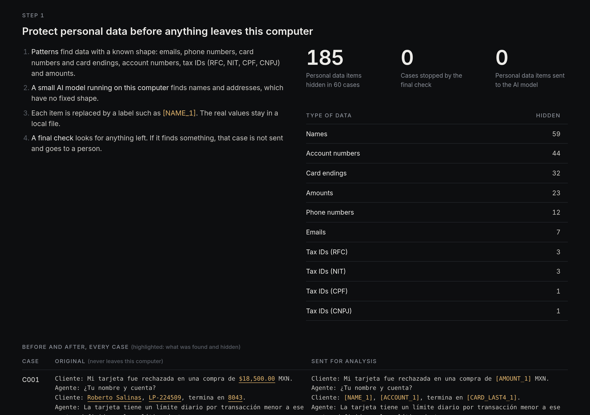
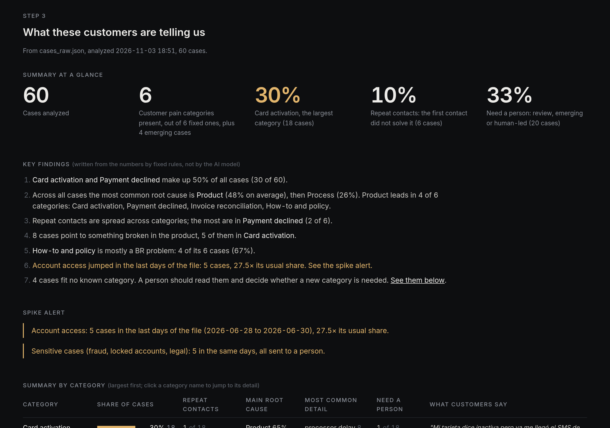
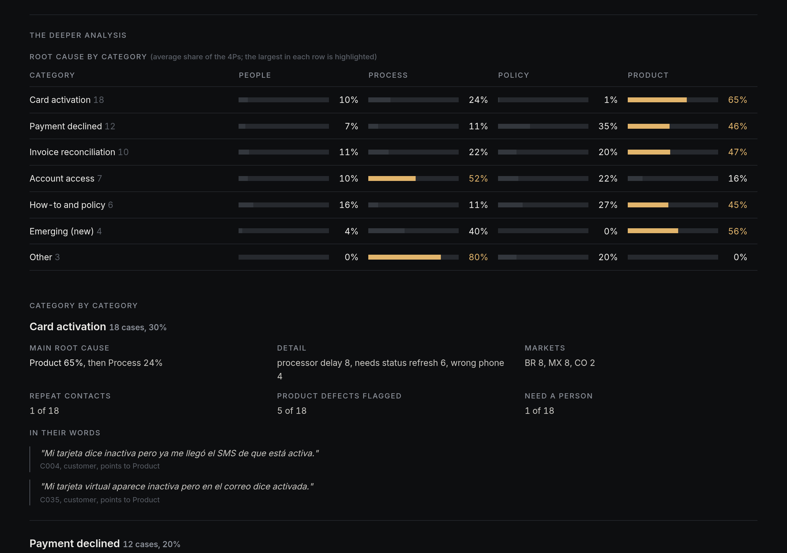

# UpstreamW

Turns closed customer support conversations into clear signals for Operations and Product: what customers struggle with, why, and who should look at it. Personal data is hidden on the local machine before anything reaches a cloud model.

**[Open the live demo](https://daniel-wing.github.io/upstreamw/)**: a finished analysis of 60 synthetic support conversations, read-only, no sign-in.

Version 0.1. All data is synthetic: LumenPay is an invented B2B payments company in Mexico, Brazil and Colombia. No real customer, company or system is involved.

## The problem

Support teams close thousands of conversations, but the reasons behind them rarely reach the people who can fix the cause. Reading cases by hand is slow, tags are inconsistent, and sending raw conversations to an AI service exposes customer data.

## What it does

Upload a file of closed conversations. UpstreamW shows three steps.

1. **Protect personal data.** Names, emails, phones, card numbers, tax IDs, account IDs, addresses and amounts are replaced with tokens like `[NAME_1]` on the local machine. A blocking check then searches the text again. If anything personal remains, the case is not sent and goes to a person.
2. **Sort each case.** A cloud model reads only the masked text. It gives each case a customer pain category and a root cause split across the 4Ps (People, Process, Policy, Product), with quotes, a confidence level and a next step. Rules then decide the route:
   - **Auto-tag** when confidence is high.
   - **Review queue** when confidence is medium, the case is ambiguous, or the customer contacted support again.
   - **Human-led** when confidence is low, or for any risk case (fraud, unrecognized charges, account takeover, lockouts, legal). Risk cases always go to a person.
   - **Emerging** when a case fits no category. It is listed for a person to name, never forced into "other".
3. **What customers are telling us.** This step shows:
   - a summary at a glance: headline numbers, key findings, and a table per category with repeat contacts, the main root cause and customer quotes
   - spike alerts
   - every case that fits no category, in full
   - a breakdown by market and root cause

It is a decision-support tool. It does not make business recommendations; it gives the people who review cases faster answers, specific cases and context.

## How the data flows

```
 Support conversations (file upload)
        |
        v
 1. Mask on the local machine      names, contact details, cards, IDs, amounts -> tokens
        |                          token map stays local
        v
 2. Leak check (blocking)          anything personal left? -> stop, send to a person
        |
        v
 3. Classify (cloud model)         masked text only -> category, 4P root cause, confidence
        |
        v
 4. Route (fixed rules)            auto-tag | review queue | human-led | emerging
        |
        v
 5. Summary, spike alerts, deeper analysis
```

## How far to trust it

Tested on 60 labeled synthetic conversations from Mexico, Brazil and Colombia:

| Check | Result |
|---|---|
| Customer pain category matches the reviewed label | 98% (59 of 60) |
| Personal data found in what was sent to the cloud | 0 |
| Risk cases not sent to a person | 0 |
| Main root cause (top P) matches the reviewed label | 52%, so a person confirms it |

The labels were written with AI help and reviewed by a person, so these numbers measure agreement with reviewed labels, not real-world accuracy. Real conversations need their own test first.

## Screens

| | |
|---|---|
|  |  |
| Step 1: personal data hidden, before and after | Step 3: summary at a glance |



## Source code

The source code is private. This repository holds the description and the read-only demo only. Copyright (c) 2026 Daniel Wing, all rights reserved; see [LICENSE](LICENSE).
